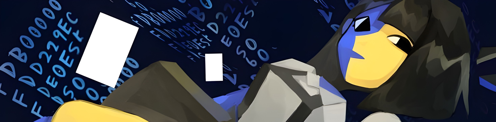

    

    
    &nbsp;
    

---

<section id="sobreMim">
    
    

        <blockquote>👋🏻 Hi there! I'm <strong>Downzin</strong> 😸, a tech enthusiast who enjoys creating projects, exploring new technologies, and bringing ideas to life through code. I'm interested in web development, design, and creative projects. I'm always looking for new things to learn and ways to improve my skills. ( •̀ ω •́ )✧
    

    

        <blockquote>🧩 I'm deeply interested in art, anime, games, and surreal worlds — especially <strong>ENA by Joel G</strong>. I love the strange, colorful, and unpredictable side of creativity, and I try to bring a little of that inspiration into my projects. Whether I'm coding, experimenting with design, or exploring new ideas, I'm always building something new.
    

    

        <blockquote>✨ <em>Somewhere between logic and chaos, I'm finding my own way.</em>
    

</section>
<section id='skills'>
    

        <h3>🚀 Languages, Technologies & Frameworks 💻</h3>
        

            
             
            
        

    

</section>
<section id="status">
    

        <h1>📊 My Stats 📊</h1>
        

            
            
        

    
  
    
I am constantly seeking to improve my skills and expand my knowledge in the various technologies I’ve mentioned. The learning journey is ongoing, and I’m excited to explore new opportunities and challenges.😸

</section>
<section id="contato">
    

        <h1>💻 Contact</h1>
        
<blockquote>😀 If you have any suggestions, feedback, or want to collaborate on a project, I’d be happy to hear from you! 😁 I am constantly seeking to improve my skills and expand my knowledge in the various technologies I’ve mentioned. The learning journey is ongoing, and I’m excited to explore new opportunities and challenges. 😸</blockquote>

        

            
            
            
            
            
        

    

</section>

 

